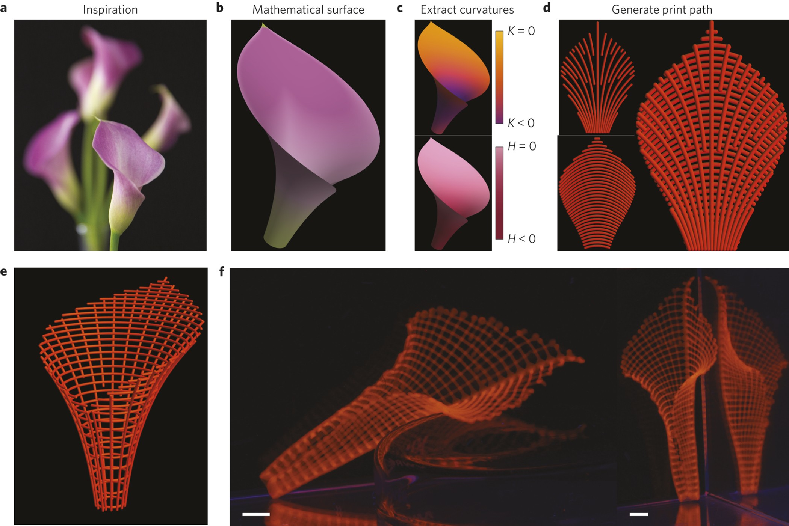
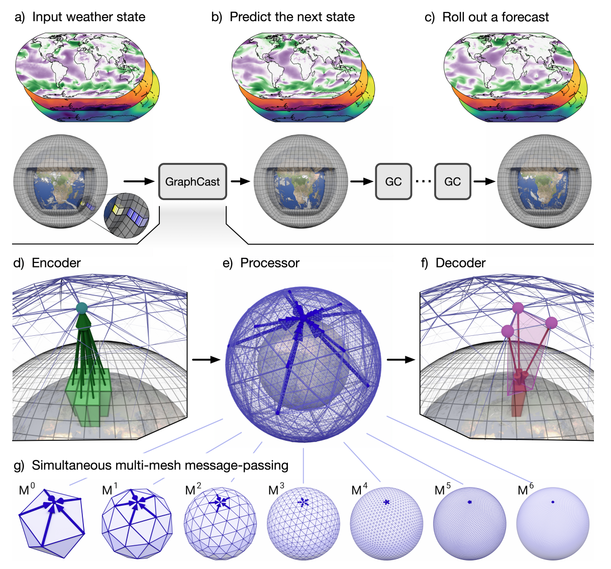
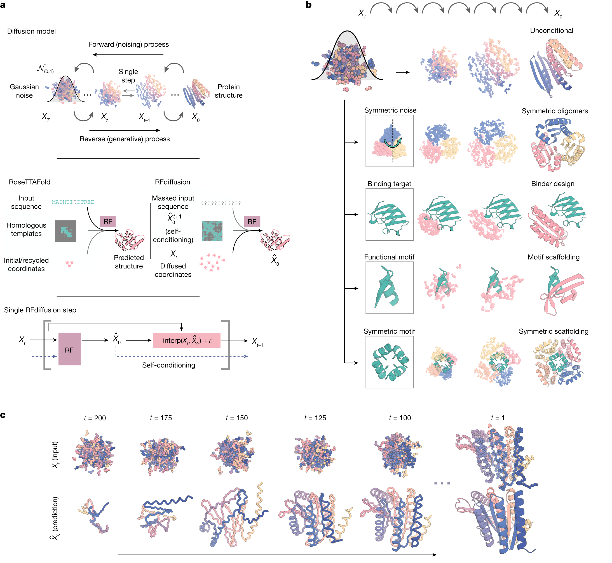
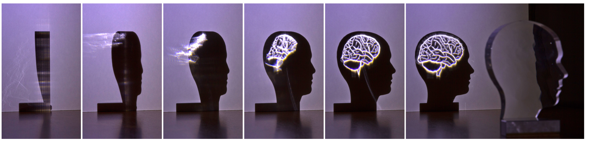
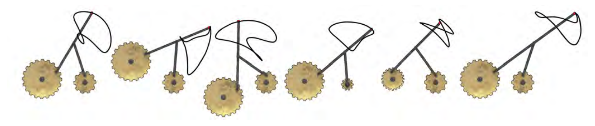

<h1 align="center">MechanismFigures</h1>

<p align="center"><b>A skill for scientific figures in which the visual construction explains the mechanism.</b><br>Real published calibration. Evidence-linked SVG construction. Rendered critique and repair.<br>For Codex, Claude Code, OpenCode, and other Agent Skills-compatible hosts.</p>

<p align="center">
  <a href="https://agentskills.io/specification">Agent Skills</a> ·
  <a href="https://github.com/KumarNavish/MechanismFigures/actions">Tests</a> ·
  <a href="LICENSE">MIT code</a> ·
  <a href="THIRD_PARTY.md">Separate figure rights</a>
</p>

<p align="center">
  <a href="#quick-start">Quick start</a> · <a href="#gallery">Gallery</a> ·
  <a href="#what-it-makes">What it makes</a> · <a href="#install">Install</a> ·
  <a href="#usage">Usage</a> · <a href="#how-it-works">How it works</a> · <a href="#limits">Limits</a>
</p>

<p align="center"><a href="https://kumarnavish.github.io/MechanismFigures/assets/gallery.html#bioprint4d"></a></p>
<p align="center"><sub><b>Published reference, not a skill-generated result.</b> Gladman et al., <i>Nature Materials</i> 2016, Figure 4. <a href="references/cases/bioprint4d.md">Read the construction</a> · <a href="THIRD_PARTY.md">Source and rights</a>.</sub></p>

Ask for the relationship the reader must understand—not a prettier chart. The agent identifies the scientific objects, inspects two relevant published figures, chooses a visual construction, builds from real evidence, and inspects the actual output at final size and 4× detail. It keeps the same entities traceable through the mechanism and makes every meaningful arrow, position and transformation accountable.

The repository itself is the skill: `SKILL.md` is at the root. No second nested copy of the instructions. No generated showcase replaces the published calibration set.

## Quick start

```sh
npx skills add KumarNavish/MechanismFigures -g -a codex
```

Then, in Codex:

```text
$mechanism-figures explain the mechanism in this paper using its actual evidence.
Make an editable SVG and a final-size preview; inspect and refine them against the published references.
```

For Claude Code use `-a claude-code`, then `/mechanism-figures`. For OpenCode use `-a opencode` and its skill picker. To select several agents, pass multiple `-a` flags. The third-party installer needs a compatible Node version and network access; the scientific kit and review helpers use Python's standard library, without model APIs.

**[Full reference reader](https://kumarnavish.github.io/MechanismFigures/assets/gallery.html)** · **[Watch the workflow](https://kumarnavish.github.io/MechanismFigures/assets/motion.html)** · **[Download releases](https://github.com/KumarNavish/MechanismFigures/releases)**

## Gallery

<table>
<tr>
<td width="50%"></td>
<td width="50%"></td>
</tr>
<tr>
<td><sub><b>GraphCast.</b> Preserve the problem's physical substrate while information changes representation. <a href="references/cases/graphcast.md">Reading and transfer</a>.</sub></td>
<td><sub><b>RFdiffusion.</b> Keep the constraint visible while the surrounding structure forms. <a href="references/cases/rfdiffusion.md">Reading and transfer</a>.</sub></td>
</tr>
<tr>
<td></td>
<td></td>
</tr>
<tr>
<td><sub><b>Computational Caustics.</b> Join a designed optical map to its physical consequence. <a href="references/cases/caustics.md">Construction and source</a>.</sub></td>
<td><sub><b>Mechanical Characters.</b> The mechanism's geometry determines the path it can trace. <a href="references/cases/mechanical.md">Construction and source</a>.</sub></td>
</tr>
</table>

All five images above are original published reference assets, not outputs made by this skill. The complete reader contains **20 references and 29 image assets**, with source credits, three-step visual readings, transfer recipes, and scientific boundaries. The eight references you retired remain excluded; this update changes packaging and craft tools, not the selection.

## What it makes

| Output | What must be true | Shipped support |
|---|---|---|
| **Scientific SVG + preview** | A spatial, temporal, structural or geometric relation carries the explanation; data and axes stay faithful. | `kit/scene.py`, `kit/geometry.py`, source/evidence contracts and rendered checks. |
| **Multi-panel mechanism figure** | Entity identity, controls and coordinate meanings survive each panel change. | Stable IDs and anchors, explicit transformations, construction and comparison recipes. |
| **Interactive scientific explainer** | State, geometry, readouts and narrative come from one declared model; motion has scientific meaning. | Optional `kit/motion.mjs`, a local capture tool, and motion-specific review rules. |

The helpers are deliberately small. They do not invent the scientific model, lay out the whole paper, certify 3D collisions, or supply a WebGL renderer. Use the project's existing renderer for complex solids, fields or volumes. The same evidence and visual-review requirements still apply.

## Install

| Method | Command / action | Scope |
|---|---|---|
| **Standard skills CLI** | `npx skills add KumarNavish/MechanismFigures -g -a codex` | Personal skill across local projects. Swap the agent or select several. |
| **CLI, one project** | `npx skills add KumarNavish/MechanismFigures` | Interactive project-level installation. |
| **Direct Git clone** | `git clone https://github.com/KumarNavish/MechanismFigures.git ~/.agents/skills/mechanism-figures` | An unused Codex/shared skill location; root `SKILL.md` is immediately available. |
| **Download** | Unpack the standalone skill ZIP into the host's personal skill directory. | No Git required. Keep all files beside `SKILL.md`. |
| **Managed Python installer** | `python3 install.py --global --agents all` from a checkout | Conservative updates, previous-version retention, doctor and recovery for the documented host registry. |

Pick **one owner for each installation**. Do not point the skills CLI or `git clone` at an existing managed folder. Use its original installer to update it, or select a different scope. `--agents all` is a finite registry, not a promise of universal account access.

<details><summary><b>Existing Python-managed installation</b></summary>

```sh
git pull --ff-only
python3 install.py --global --agents all --update
python3 install.py --doctor
```

Run from the maintained source checkout, not from an arbitrary agent-generated folder. The installer verifies existing hashes and preserves the prior managed version. It refuses unmanaged or edited targets. [Installation and recovery](docs/INSTALL.md).
</details>

<details><summary><b>Requirements and privacy</b></summary>

Python 3.9+ runs the geometry and review helpers with no third-party dependencies. Optional `scripts/capture.mjs` needs Node 22+ and an already installed Chrome/Chromium. The `skills` installer is a separate third-party program; the checked 1.7.2 package declares Node ≥22.20. Its telemetry can be disabled with `DISABLE_TELEMETRY=1`. No agent model is started by installation or file tests. Browser checks never add sandbox-disabling flags.

Local scope is not web/mobile/account scope. Refresh host discovery and explicitly invoke the skill where needed. [Host-specific boundaries](docs/HOSTS.md).
</details>

## Usage

Supply four things: **context, mechanism/result, evidence, and output constraints**. The agent fills the detailed contract.

```text
Use mechanism-figures. Our method keeps a specified motif fixed while optimizing
its surrounding structure. Use the actual saved intermediate states and comparator.
Make the invariant and the changed region obvious in a 180 mm-wide figure.
```

```text
Use mechanism-figures for this measured propagation process. Align geometry and
time so readers can predict where the transition moves next. Distinguish measured
frames from simulations. Deliver SVG, preview, caption, source, and review.
```

Name the idea and the real evidence before specifying a drawing style. Isometric depth is useful when it exposes a real interface or occlusion; it is not a compulsory look for every domain.

## How it works

**Truth → visual world → parts and relations → implementation → rendered inspection → repair.**

1. Isolate one claim, its assumptions, comparator and falsifier.
2. Inspect two current published references and propose two genuinely different constructions.
3. Inventory the entities, interfaces, constraints, updates and evidence. A part earns its place by explaining something.
4. Build geometry from that model; preserve identities and attach labels to the objects they define.
5. Inspect the full-size render and 4× details. Test boundary cases, incorrect inferences, inaccessible controls and misleading motion.
6. Repair the mechanism before the finish. Keep rejected drafts and version-bound review evidence.

**Quality gate:** ≥90/100 overall, every dimension ≥4/5, fidelity 5/5, every hard gate passed. The score is an evidence-linked review policy—not automated proof of beauty or scientific correctness. [Full rubric](references/critique.md).

```text
MechanismFigures/
├── SKILL.md           one installable entry point
├── kit/               explicit SVG geometry and model-driven playback helpers
├── references/        craft, construction, motion, verification and case readings
├── assets/            actual published calibration images, reader and walkthrough
├── scripts/           contract, provenance, review and rendered capture tools
├── agents/            optional host metadata
├── evals/             task prompts and observable acceptance criteria
├── tests/             tooling regressions; not a visual-quality benchmark
└── tools/             maintainers' builders, packaging and conservative installer
```

The [Anatomy adaptation record](docs/ANATOMY_STANDARD.md) identifies the conventions adopted from the supplied repository and the deliberate scientific differences. Anatomy is credited as the reference standard; its implementation and images are not copied into our calibration set.

## Verify a figure

```sh
python3 scripts/mf.py preflight /path/to/figure/figure.json
node scripts/capture.mjs /path/to/figure/figure.svg --out-dir /path/to/review-r1 --selector svg
python3 scripts/mf.py review-init /path/to/figure/figure.json --out /path/to/figure/review-r1.json
# Read the actual captures, inspect the evidence, then complete the review:
python3 scripts/mf.py gate /path/to/figure/figure.json /path/to/figure/review-r1.json
```

Capture produces a 1× view, 4× detail tiles and a file-bound report. It cannot pass the aesthetic review for you. HTML execution requires explicit `--allow-active`; HTTP(S) and WebSocket requests are blocked during capture. Use an allowed browser environment rather than weakening security controls.

## Limits

This is not a chart theme or a promise of seminal results. It does not force forty parts, gears, cards, decorative textures or 3D onto a mechanism that needs another representation. Published images remain the visual standard; test fixtures are not promoted into a showcase. No cross-agent efficacy study or universal account activation is claimed.

**[Start here](START_HERE.md)** · **[Maintainer guide](docs/MAINTAINING.md)** · **[Evaluation protocol](benchmarks/PROTOCOL.md)** · **[Security](SECURITY.md)**

Original code and commentary: MIT. Published figure rights and restrictions remain separate in [THIRD_PARTY.md](THIRD_PARTY.md).
