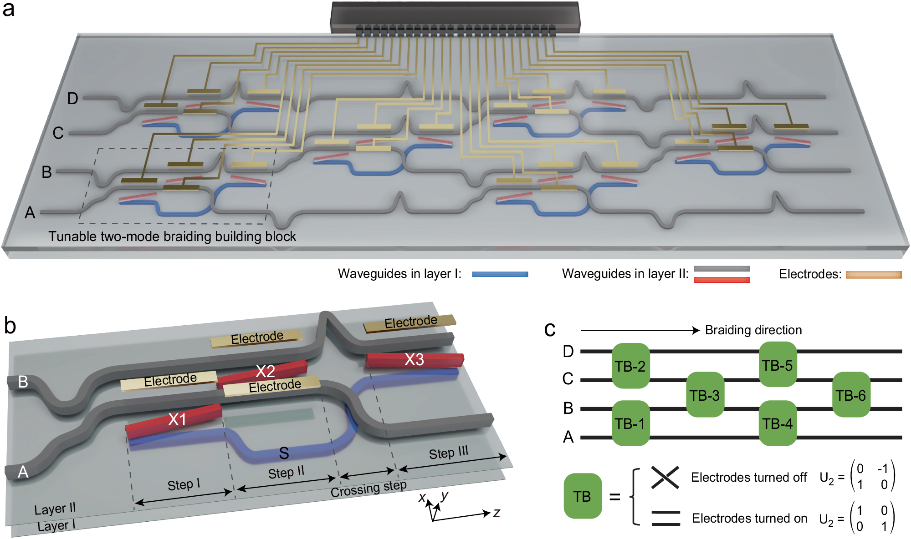
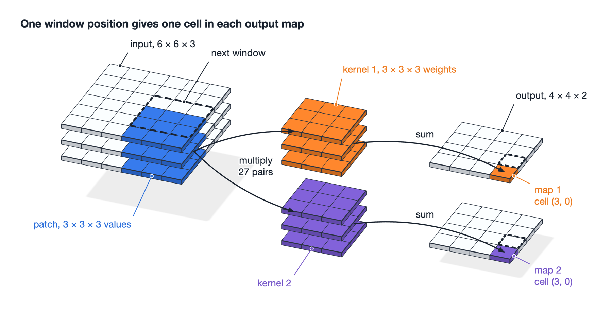
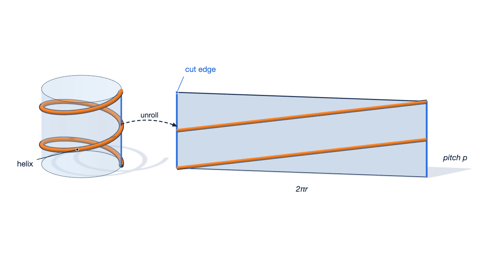

<h1 align="center">MechanismFigures</h1>

<p align="center"><b>An agent skill for figures that show how a system works.</b><br>Think in 3D first. Look at real published figures. Render, look, repair.</p>

<p align="center"><a href="https://kumarnavish.github.io/MechanismFigures/assets/gallery.html"></a></p>
<p align="center"><sub>A published reference from the atlas, not an output of this skill. Sun et al., <i>Nature Communications</i> 2025, Figure 1. <a href="THIRD_PARTY.md">Source and rights</a>.</sub></p>

A mechanism figure passes one test: **a reader who sees only the picture can predict what the system does next.** A list of parts fails the test. A pipeline of boxes fails the test. This skill makes an agent draw the object, the operation on it and the consequence.

## Install

```bash
npx skills add KumarNavish/MechanismFigures -g -a claude-code
```

Use `-a codex` or `-a opencode` for those hosts. The other route:

```bash
git clone https://github.com/KumarNavish/MechanismFigures.git && cd MechanismFigures && python3 install.py --global --agents all
```

Then ask the agent: *"Use mechanism-figures. Show how [your system] works. Read the code and the paper first."*

The 3D stage needs Node 22 or later and an installed Chrome or Chromium. Details: [docs/INSTALL.md](docs/INSTALL.md).

## What the agent gets

| Part | What it is |
|---|---|
| **[The loop](SKILL.md)** | Six steps: write the mechanism sentence, name the cast, look at real figures, select a move, build in three passes, look and repair. |
| **[The atlas](https://kumarnavish.github.io/MechanismFigures/assets/gallery.html)** | 42 published figures, 55 images. 37 of the figures use 3D. Each one has a claim title, three places to look, the reason that it works and what to take from it. |
| **[Fifteen moves](references/moves.md)** | Cutaway, exploded view, layer stack, ghost and focus, fixed-camera sequence, unroll pair, ray trace, field on geometry, linked zoom, state-space geometry, index to geometry, target to consequence, matched counterfactual, loop through one object, block diagram. |
| **[The 3D stage](references/stage.md)** | A three.js studio with an orthographic camera, soft contact shadows, outlines, capped cuts, exploded parts with tethers and vector labels. One command renders a PNG, an SVG with editable labels, detail tiles, a grayscale copy and a report. |
| **[Clarity and cinematic flow](references/story.md)** | Rules from two public pages: the title is the claim, each panel has a decode line, one stage, one change for each beat. The stage renders beats with a fixed camera and writes a scroll page. |
| **[Craft](references/craft.md), [truth](references/truth.md), [critique](references/critique.md)** | Camera and depth cues. What a picture must not imply. Seven questions for each render, with a table of defects and repairs. |

## A trial

<p align="center"></p>
<p align="center"><sub>Made in a trial of version 1.0.0: a new agent got only the skill and one paragraph of task text, and used 5 renders. It is one trial, not a benchmark. The agent's own critique found two defects that remain: 11 labels, and arrows that cross output cells.</sub></p>

## The stage

<p align="center"></p>
<p align="center"><sub>Output of <code>kit/template.mjs</code>: the unroll-pair move. It is a starting template and an API demonstration, not a quality standard. The atlas is the standard.</sub></p>

```js
// figure.mjs
export const view = {width: 180, height: 100, azim: -50, elev: 28};
export default function build(S, THREE) {
  const shell = S.solid(new THREE.SphereGeometry(1, 64, 40), {color: S.palette.context});
  S.sphere([0, 0, 0], 0.45, {color: S.palette.act});
  S.cut(shell, [0, 0, 0], [0.2, -1, 0.15]);          // capped cutaway
  S.label([0, 0, 0.45], 'core', {dx: 5, dy: -14});   // editable vector label
}
```

```bash
node scripts/render.mjs figure.mjs --out out
```

No network. No model call. three.js r170 is in `kit/vendor`.

## Limits

- The skill makes the agent look and repair. It does not prove that a figure is good or true. A person must review the science.
- The stage output is a raster with vector labels. The 3D geometry is not vector.
- The 22 references that were added in version 1.0.0 are curator selections. See [docs/CURATION.md](docs/CURATION.md).
- Reference figures are third-party material with their own licences. The MIT licence covers the code and the text only. See [THIRD_PARTY.md](THIRD_PARTY.md).

## Maintain

[docs/MAINTAINING.md](docs/MAINTAINING.md) · [CHANGELOG.md](CHANGELOG.md) · [CONTRIBUTING.md](CONTRIBUTING.md) · MIT
